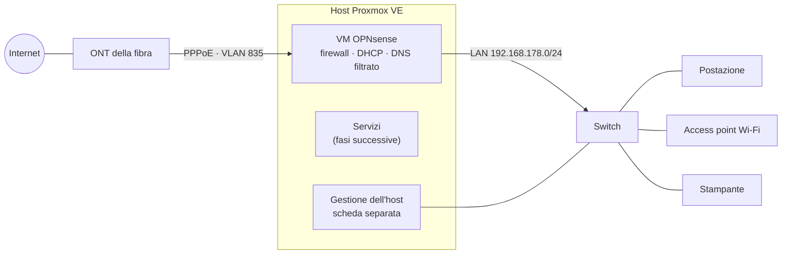

# HomeLab

🇬🇧 [English](README.md) | 🇮🇹 Italiano

Una rete di casa ricostruita attorno a un solo host Proxmox VE che fa anche da router: OPNsense in una VM con due porte di rete fisiche in passthrough, backup notturni, avvisi su Telegram e un laboratorio di sicurezza (Suricata, SIEM) in arrivo. Costruita per imparare gli strumenti del lavoro SOC e blue team, e documentata strada facendo, compreso ciò che è andato storto.

## In breve

- **Router e firewall:** VM OPNsense 26.7, PPPoE su VLAN su una linea in fibra, DHCP Kea, DNS Unbound, nessun accesso in ingresso dalla WAN.
- **Filtro DNS:** pubblicità, tracker e domini malevoli noti bloccati per tutti i dispositivi; il DNS mandato a server esterni viene dirottato sul filtro, il DNS su TLS viene rifiutato.
- **Hypervisor:** Proxmox VE 9.2 senza monitor, SSH solo con chiave, una procedura di emergenza provata.
- **Resilienza:** backup notturni in modalità snapshot con conservazione, ripristini provati (container e VM), export delle configurazioni cifrati.
- **Monitoraggio:** avvisi scritti da me in Bash e Python con systemd: storage, SMART, temperature, servizi in errore, interruzioni di gateway e PPPoE con la loro durata; avvisi solo ai cambi di stato.
- **Igiene dei segreti:** hook pre-commit (gitleaks + denylist personale, fail-closed); credenziali mai passate come argomenti dei processi.
- **Prossimi passi:** VPN WireGuard, IDS/IPS con Suricata, Wazuh contro Splunk.

## Rete



Hardware: AMD Ryzen 5 9600X, 32 GB di RAM, NVMe da 256 GB (sistema e guest), HDD da 1 TB (backup), 2,5 GbE integrata per la gestione, scheda Intel i226-V a due porte per WAN e LAN. Gli schemi dettagliati sono nelle write-up.

## Roadmap

| Fase | Argomento | Stato | Write-up |
|---|---|---|---|
| 0 | Host Proxmox senza monitor | ✅ fatta | [IT](docs/it/phase-0-headless-proxmox.md) · [EN](docs/en/phase-0-headless-proxmox.md) |
| 1 | Backup | ✅ fatta | [IT](docs/it/phase-1-backups.md) · [EN](docs/en/phase-1-backups.md) |
| 2 | OPNsense in laboratorio | ✅ fatta | [IT](docs/it/phase-2-opnsense-lab.md) · [EN](docs/en/phase-2-opnsense-lab.md) |
| 3 | Il passaggio: OPNsense diventa il router di casa | ✅ fatta | [IT](docs/it/phase-3-cutover.md) · [EN](docs/en/phase-3-cutover.md) |
| T | Avvisi e monitoraggio | ✅ host e router · 🔜 per servizio | [script](scripts/miniserver/) |
| U | Più spazio, servizi pesanti su un secondo server | 🟡 preparata | – |
| 4 | Filtro DNS | ✅ fatta | [IT](docs/it/phase-4-dns-filter.md) · [EN](docs/en/phase-4-dns-filter.md) |
| 5 | VPN WireGuard | 🔜 prossima | – |
| 6 | Piccolo NAS (Samba) | ⏳ prevista | – |
| 7 | Reverse proxy e certificati | ⏳ prevista | – |
| 8 | Vaultwarden | ⏳ prevista | – |
| I | IPv6 | ⏳ prevista | – |
| 9 | Suricata, prima IDS poi IPS | ⏳ prevista | – |
| 10 | SIEM: Wazuh contro Splunk, poi uno dei due | ⏳ prevista | – |
| – | Segmentazione in VLAN | ⏸ in attesa di un access point gestibile | – |

L'ordine è voluto: prima un host gestibile e recuperabile, poi la rete, poi i servizi, e il monitoraggio di sicurezza per ultimo, quando c'è una rete vera da sorvegliare.

## Mappa delle competenze

| Competenza | Dove si vede |
|---|---|
| Hardening di Linux e SSH | [Fase 0](docs/it/phase-0-headless-proxmox.md) |
| Backup, ripristino e prove di recupero | [Fase 1](docs/it/phase-1-backups.md), [Fase 2](docs/it/phase-2-opnsense-lab.md) |
| Progettazione di firewall e rete: PPPoE, VLAN, DHCP, DNS | [Fase 2](docs/it/phase-2-opnsense-lab.md), [Fase 3](docs/it/phase-3-cutover.md), [Fase 4](docs/it/phase-4-dns-filter.md) |
| Virtualizzazione e passthrough PCI | [Fase 2](docs/it/phase-2-opnsense-lab.md) |
| Troubleshooting di rete: TTL, ARP, MTU, DHCP | [Fase 3](docs/it/phase-3-cutover.md) |
| Sicurezza del DNS: filtro, prevenzione dell'aggiramento del resolver, diagnosi dai log | [Fase 4](docs/it/phase-4-dns-filter.md) |
| Gestione delle modifiche e piani di rientro | [Fase 2](docs/it/phase-2-opnsense-lab.md), [Fase 3](docs/it/phase-3-cutover.md) |
| Monitoraggio e avvisi: Bash, Python, systemd | [scripts/miniserver](scripts/miniserver/) |
| Script sicuri: segreti fuori dagli argomenti, accesso API con privilegi minimi | [scripts/miniserver](scripts/miniserver/) e la sua storia dei commit |
| Gestione dei segreti in Git | [Politica sui segreti](docs/it/secrets-policy.md), [hook pre-commit](.githooks/pre-commit) |
| IDS, SIEM, rilevamento e analisi degli incidenti | in arrivo con le Fasi 9–10: `detections/`, `incidents/` |

## Come lavoro

- **Prima il laboratorio, poi il passaggio.** Il router è stato costruito e provato mentre la rete di casa continuava a funzionare con quello vecchio.
- **Un'incognita alla volta,** con una via di ritorno scritta.
- **Niente è fatto finché non è provato,** compresi i casi di guasto: spegnimento forzato, disco dei backup smontato, interruzione simulata, un servizio che va in errore.
- **Il repository è la fonte** degli script dell'host; le differenze tra repository e host vengono controllate.
- **Nessun segreto in Git,** garantito da un hook, non dalla memoria.

## Struttura del repository

```
docs/en, docs/it      write-up per fase, politiche
scripts/miniserver/   script di avviso dell'host, unità systemd, installer
configs/              configurazioni ripulite (in arrivo)
detections/           regole e ricerche del SIEM (in arrivo)
incidents/            report di incidenti simulati (in arrivo)
.githooks/            controllo dei segreti prima del commit
```

Dopo il clone, attivare l'hook con `git config core.hooksPath .githooks`. Servono [gitleaks](https://github.com/gitleaks/gitleaks) e un file denylist in `~/.config/homelab/denylist.txt`, anche vuoto: senza, ogni commit viene bloccato, per scelta.

## Licenza

[MIT](LICENSE)
