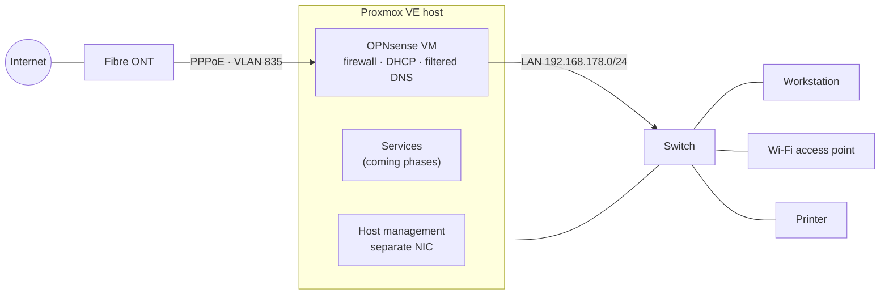

# HomeLab

🇬🇧 English | 🇮🇹 [Italiano](README.it.md)

A home network rebuilt around a single Proxmox VE host that is also the router: OPNsense as a VM with two physical NIC ports passed through, nightly backups, Telegram alerting, and a security lab (Suricata, SIEM) on the way. Built to learn the tools used in SOC and blue-team work, and documented as I go, including what went wrong.

## At a glance

- **Router and firewall:** OPNsense 26.7 VM, PPPoE over VLAN on a fibre line, Kea DHCP, Unbound DNS, no inbound access from the WAN.
- **DNS filtering:** ads, trackers and known malicious domains blocked for every device; DNS sent to outside servers is redirected to the filter, DNS over TLS is refused.
- **Hypervisor:** Proxmox VE 9.2, headless, key-only SSH, a tested emergency runbook.
- **Resilience:** nightly snapshot backups with retention, restores tested (container and VM), encrypted configuration exports.
- **Monitoring:** my own alerting in Bash and Python with systemd: storage, SMART, temperatures, failed services, gateway and PPPoE outages with their duration; alerts only on state changes.
- **Secrets hygiene:** pre-commit hook (gitleaks + personal denylist, fail-closed); credentials never passed as process arguments.
- **Next:** WireGuard VPN, Suricata IDS/IPS, Wazuh vs Splunk.

## Network



Hardware: AMD Ryzen 5 9600X, 32 GB RAM, 256 GB NVMe (system and guests), 1 TB HDD (backups), onboard 2.5 GbE for management, dual-port Intel i226-V card for WAN and LAN. Detailed layouts are in the write-ups.

## Roadmap

| Phase | Topic | Status | Write-up |
|---|---|---|---|
| 0 | Headless Proxmox host | ✅ done | [EN](docs/en/phase-0-headless-proxmox.md) · [IT](docs/it/phase-0-headless-proxmox.md) |
| 1 | Backups | ✅ done | [EN](docs/en/phase-1-backups.md) · [IT](docs/it/phase-1-backups.md) |
| 2 | OPNsense in a lab | ✅ done | [EN](docs/en/phase-2-opnsense-lab.md) · [IT](docs/it/phase-2-opnsense-lab.md) |
| 3 | Cut-over: OPNsense becomes the home router | ✅ done | [EN](docs/en/phase-3-cutover.md) · [IT](docs/it/phase-3-cutover.md) |
| T | Alerting and monitoring | ✅ host and router · 🔜 per service | [scripts](scripts/miniserver/) |
| U | Storage upgrade, bulk services to a second server | 🟡 prepared | – |
| 4 | DNS filtering | ✅ done | [EN](docs/en/phase-4-dns-filter.md) · [IT](docs/it/phase-4-dns-filter.md) |
| 5 | WireGuard VPN | 🔜 next | – |
| 6 | Small NAS (Samba) | ⏳ planned | – |
| 7 | Reverse proxy and certificates | ⏳ planned | – |
| 8 | Vaultwarden | ⏳ planned | – |
| I | IPv6 | ⏳ planned | – |
| 9 | Suricata, IDS then IPS | ⏳ planned | – |
| 10 | SIEM: Wazuh vs Splunk, then one | ⏳ planned | – |
| – | VLAN segmentation | ⏸ waiting for a managed access point | – |

The order is deliberate: first a host that can be managed and recovered, then the network, then services, and security monitoring last, when there is a real network to watch.

## Skills map

| Skill | Where it shows |
|---|---|
| Linux and SSH hardening | [Phase 0](docs/en/phase-0-headless-proxmox.md) |
| Backup, restore and recovery testing | [Phase 1](docs/en/phase-1-backups.md), [Phase 2](docs/en/phase-2-opnsense-lab.md) |
| Firewall and network design: PPPoE, VLAN, DHCP, DNS | [Phase 2](docs/en/phase-2-opnsense-lab.md), [Phase 3](docs/en/phase-3-cutover.md), [Phase 4](docs/en/phase-4-dns-filter.md) |
| Virtualization and PCI passthrough | [Phase 2](docs/en/phase-2-opnsense-lab.md) |
| Network troubleshooting: TTL, ARP, MTU, DHCP | [Phase 3](docs/en/phase-3-cutover.md) |
| DNS security: filtering, resolver-bypass prevention, log-based diagnosis | [Phase 4](docs/en/phase-4-dns-filter.md) |
| Change management and rollback planning | [Phase 2](docs/en/phase-2-opnsense-lab.md), [Phase 3](docs/en/phase-3-cutover.md) |
| Monitoring and alerting: Bash, Python, systemd | [scripts/miniserver](scripts/miniserver/) |
| Secure scripting: secrets out of argv, least-privilege API access | [scripts/miniserver](scripts/miniserver/) and its commit history |
| Secrets management in Git | [Secrets policy](docs/en/secrets-policy.md), [pre-commit hook](.githooks/pre-commit) |
| IDS, SIEM, detection and incident analysis | coming in Phases 9–10: `detections/`, `incidents/` |

## How I work

- **Lab first, cut-over second.** The router was built and tested while the home network kept running on the old one.
- **One unknown at a time,** with a written way back.
- **Nothing is done until tested,** failure paths included: forced power-off, unmounted backup disk, simulated outage, a service that crashes.
- **The repository is the source of truth** for the host's scripts; drift between repository and host is checked.
- **No secrets in Git,** enforced by a hook, not by memory.

## Repository layout

```
docs/en, docs/it      write-ups per phase, policies
scripts/miniserver/   host alerting scripts, systemd units, installer
configs/              sanitized configurations (coming)
detections/           SIEM rules and searches (coming)
incidents/            reports on simulated incidents (coming)
.githooks/            pre-commit secret scanning
```

After cloning, enable the hook with `git config core.hooksPath .githooks`. It needs [gitleaks](https://github.com/gitleaks/gitleaks) and a denylist file at `~/.config/homelab/denylist.txt`, even an empty one: without them every commit is blocked, by design.

## License

[MIT](LICENSE)
