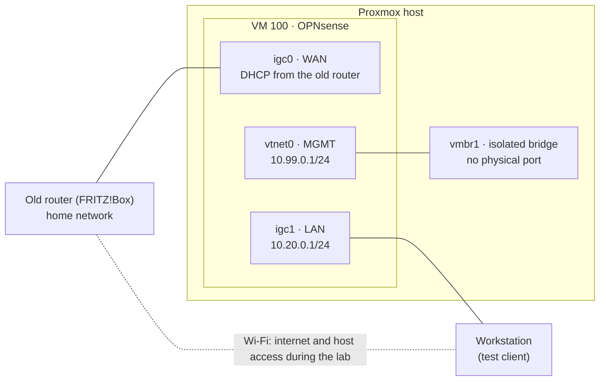

# Phase 2 – OPNsense in a lab

*October 2026 · OPNsense 26.7 on Proxmox VE 9.2 · [Versione italiana](../it/phase-2-opnsense-lab.md)*

**TL;DR** – The new router, OPNsense in a VM with two physical NIC ports passed through, was built and tested end to end while the household kept using the old router. By the end, the cut-over was reduced to moving cables and changing one setting, with a written way back.

## Goal

A fully configured and tested firewall before touching the home network: no half-finished work on the day internet goes down.

## Lab layout

## VM design

| Setting | Value | Why |
|---|---|---|
| Machine, firmware | q35, UEFI without Secure Boot keys | PCIe topology suited to passthrough |
| CPU | 4 cores, type `host` | headroom for Suricata (Phase 9) |
| RAM | 4 GB, fixed, no ballooning | with PCI passthrough all guest memory is pinned anyway |
| Disk | 32 GB on the NVMe, UFS | lighter than ZFS; recovery goes through Proxmox backups |
| NICs | 2 × Intel i226-V in PCI passthrough + 1 virtual NIC on `vmbr1` | real hardware for WAN and LAN, a virtual link for management |

## What I built and why

- **Passthrough without global changes.** IOMMU (AMD-Vi) was already active; each i226 port sits in its own IOMMU group, and the management NIC in a separate one. Both i226 ports share the same PCI ID, so binding by ID would grab both, and it must never touch the management NIC. I used Proxmox *Resource Mappings* (`kalea-wan`, `kalea-lan`) by PCI address instead of a static `vfio-pci` binding: the host keeps its drivers until the VM starts, and undoing it means removing a device from the VM.
- **Management that doesn't depend on the router.** An isolated Linux bridge (`vmbr1`, no physical port) links the host to OPNsense's management interface; the web GUI is reached through an SSH tunnel to the host. It never appears on the home LAN and can't overlap with it. A serial console (`qm terminal 100`) gives copy-paste, which the browser console lacks.
- **A lab that cannot hurt the home network.** The WAN port sat on the home LAN and got its address from the old router; the lab LAN used a temporary `10.20.0.0/24`, since it can't share the WAN subnet. My workstation was the test client, with a NetworkManager profile that had **no default route**: only `1.1.1.1` and `9.9.9.9` went through OPNsense, everything else stayed on Wi-Fi. A mistake in OPNsense could not cut my own internet or my access to the host.
- **Final addressing decided in the lab.** After the cut-over the LAN keeps `192.168.178.0/24`, with OPNsense on `.1`, so the host, the workstation and the switch keep their addresses; VLANs will renumber everything later anyway. Plan: `.1–.99` static addresses and reservations, `.100–.254` DHCP.
- **Services.** Kea DHCPv4 with a reservation for the workstation, Unbound as resolver, NTP and time zone. No firewall rule without a reason: the WAN has no inbound rules (default deny), and new rules arrive with the phases that need them.
- **PPPoE prepared, not used.** The fibre line needs PPPoE over VLAN 835. I read the parameters from the old router's configuration instead of asking the provider, and created the VLAN and PPPoE devices in OPNsense without assigning them: the lab kept using DHCP, and the cut-over became one change (WAN → `pppoe0`).
- **Autostart and order.** The router VM starts first with the host and gets 60 s before any other guest, because network, DHCP and DNS must be up for whatever comes next; it has 120 s for a clean shutdown.

## What went wrong and how I fixed it

**Names that lie.** The host's interface names (`nic1`, `nic2`) were crossed relative to the physical port order, and the OPNsense installer assigned `igc0`/`igc1` crossed relative to the roles I had planned. The LED-blink trick (`ethtool -p`) isn't supported by this driver, so I identified the ports with a cable and the link state, labelled them physically, and from then on trusted only MAC addresses: checked inside OPNsense, from the workstation's neighbour table on the lab LAN, and again before the cut-over.

**Locked out of the GUI by my own reassignment.** After reassigning the interfaces from the serial console, the management interface came up with no firewall rules, so the GUI was unreachable through the tunnel. I got in from the lab LAN through the anti-lockout rule and added an explicit rule: HTTPS from the management network to the firewall's management address, nothing else.

**My workstation fighting the lab.** The normal wired profile connects automatically on any cable: plugged into the lab LAN, it would have replaced the safe test profile. I disabled its autoconnect for the duration of the lab and wrote down the exact steps to switch back.

**The tools, not the plan.** The browser console has no copy-paste and OPNsense's shell is `csh`, where bash loops fail: the serial console and `sh -c '…'` solved both.

## How it was verified

"Ready for cut-over" checklist, all ticked before Phase 3:

- the test client gets an address from DHCP and browses; DNS resolves (`drill`, `NOERROR`); `tracepath` shows the expected path;
- the host stays reachable with the router VM switched off, thanks to the fixed addresses;
- a full reboot of the host brings OPNsense back on its own (boot journal: VM started first, then the 60 s delay);
- a backup of the VM with passthrough active, verified with `zstd -t`; **restore tested** with `qmrestore` to a new ID with new MACs. The copy was never started, because two VMs cannot own the same physical ports: its autostart was removed at once, and a diff of the two configurations showed only IDs, MACs and UUID changed;
- the old router's configuration exported, and a written plan to go back.

PPPoE could only be tested for real with the fibre terminal connected to OPNsense: the one unknown deliberately left for the cut-over.

## Still open

- **IPS mode for Suricata** (Phase 9) depends on netmap support for these NICs in passthrough: to check before enabling it.
- **VLANs** wait for a managed access point: the FRITZ!Box, now used as access point, can't map Wi-Fi networks to VLANs.

## Skills

Firewall virtualization · PCI passthrough and IOMMU · IP addressing, DHCP and DNS · building a safe test environment · change preparation and rollback planning
