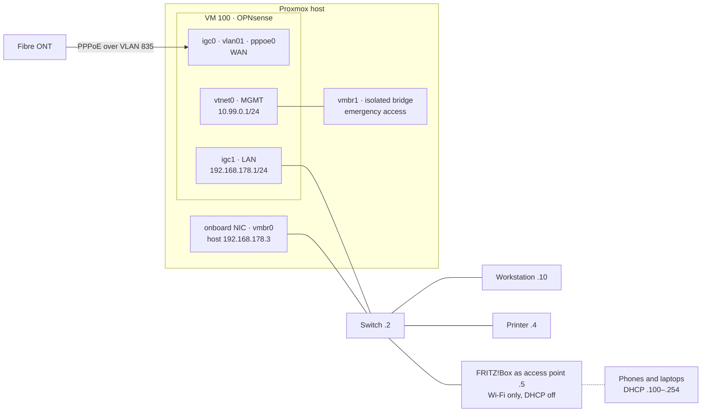

# Phase 3 – Cut-over: OPNsense becomes the home router

*24–25 October 2026 · [Versione italiana](../it/phase-3-cutover.md)*

**TL;DR** – The fibre line moved from the old router to OPNsense in one afternoon, one unknown at a time, with the old router left untouched as the way back. Everything was then verified (DHCP, DNS, MTU, Wi-Fi, a full reboot), the router got real gateway monitoring and Telegram alerts through a least-privilege API user, and its configuration was backed up encrypted.

## Final layout

## The plan: one unknown at a time

1. The old router was left **unchanged and switched off** during the cut-over: going back meant moving one cable.
2. **PPPoE first**, the only thing the lab could not test: the prepared `pppoe0` device was assigned to the WAN, and the session checked (address, gateway, internet) before anything else changed.
3. **Then the LAN**: renumbered from the lab subnet to `192.168.178.1/24`, DHCP pool `.100–.254`, workstation reservation, lease raised from about an hour to one day.
4. **The old router came back** only as an access point, configured in isolation first (below).

## What I built and why

- **Fibre straight into the firewall.** The ONT connects to OPNsense's WAN port, and PPPoE runs over VLAN 835 on that port. The physical port is assigned as an interface with no address (`WANPHY`): a VLAN only comes up if its parent device is enabled.
- **The old router as a plain access point.** FRITZ!Box in "IP client" mode with a fixed address (`.5`), DHCP and NAT off, IPv6 off, uplink on one of its LAN ports. It does Wi-Fi on two bands and nothing else.
- **Management outside the router's path.** The host's onboard NIC goes straight to the switch with a fixed address, so Proxmox stays reachable with OPNsense off; the isolated management bridge stays as an emergency route to the router's GUI.
- **IPv6 deliberately off for now.** Doing it properly doubles firewall rules, DNS filtering, VPN and IDS analysis, and one wrong rule can expose devices to the internet. It gets its own phase.

## What went wrong and how I fixed it

**Two DHCP servers is one too many, so I proved there was only one.** The FRITZ!Box was configured as an access point on an isolated cable, with my workstation on a temporary profile without a default route and internet from a phone hotspot. Before plugging it into the LAN I checked that its DHCP server was off with `nmap --script broadcast-dhcp-discover` (no answer). After the cut-over, the same test on the LAN gets exactly one offer, from OPNsense.

**The address I had planned was taken.** I meant to put the access point on `.4`. Pings to `.4` came back with two different TTLs, 64 and 255: two devices were answering. The web page on `.4` was the printer's, which had a static address set on the device itself, invisible in any DHCP table. The access point went to `.5`, and before assigning a static address I now scan the LAN with `arp-scan`, which flags duplicates.

**The boot notice that never arrived.** After the cut-over, the host's "back online" Telegram message failed on every reboot: it ran once at boot, but internet now comes from a VM on the same host, which isn't up yet. The notice now retries every 15 s for up to 15 minutes without holding up the boot, and reports how long internet took to come back (57 s on the test reboot).

**A green light that measured nothing.** The WAN gateway showed as online, but its monitoring was disabled: the icon wasn't measuring anything. I enabled `dpinger` towards a public resolver (`9.9.9.9`) rather than the PPPoE peer, which may not answer pings and only proves the first hop. With a single WAN, gateway switching stays off, so a false "down" can never change routing.

**API privileges that didn't stick.** For the alerts I created a dedicated OPNsense API user with only two privileges (gateway status, interface status). Set from the user form they were not saved, and the API kept answering `403`; assigned from the privileges page they worked, confirmed in `config.xml`. The status codes told the story: `302` (redirect to the login page) without credentials, `403` with credentials but without the privilege.

## How it was verified

- `192.168.178.1` answers with the MAC of the LAN port passed through to the VM;
- exactly one DHCP offer on the LAN, from OPNsense (domain `home.arpa`, one-day lease);
- the WAN has a public address and the provider's gateway;
- **MTU 1492** (PPPoE): `ping -M do -s 1464 1.1.1.1` passes, and with 1465 OPNsense answers "mtu = 1492";
- HTTPS and DNS from the workstation; package updates and a Telegram message from the host;
- Wi-Fi on 2.4 and 5 GHz from two phones and a laptop, all with addresses from `.100` up and gateway and DNS on `.1`;
- full reboot of the host: OPNsense comes back by itself, PPPoE reconnects, internet 57 s after boot.

## After the cut-over

- **Router alerts on Telegram** (`opnsense-check`, see [`scripts/miniserver/`](../../scripts/miniserver/)): VM stopped, API silent, PPPoE down, gateway down or degraded, public IP changed. Outages are reported with their duration as soon as internet is back.
- **Backups:** OPNsense configuration exported **encrypted**, and the old unencrypted lab export, with the PPPoE credentials in clear, deleted; access-point configuration exported; a *protected* VM backup as a fixed restore point; a second copy of these files on the host's backup disk, verified with SHA-256.
- **Runbook** extended to the router: no internet, DNS only, DHCP, PPPoE, broken configuration, VM restore, VM lost with no usable backup, access point reset. After a reset it would come back as a router with DHCP on `.1`, OPNsense's address: unplug it first.

## Still open

- **In-place restore of the router VM** from the protected backup: tested in Phase 2 on a copy, not yet in place, because it takes the whole house offline for a few minutes.
- **IPv6** (own phase), **DNS filtering** (Phase 4), **VPN** (Phase 5). The public IP is dynamic: DDNS comes with the VPN.

## Skills

Change management and rollback planning · PPPoE over VLAN · DHCP and addressing on a live network · network troubleshooting (TTL, ARP, MTU) · monitoring and least-privilege API access
