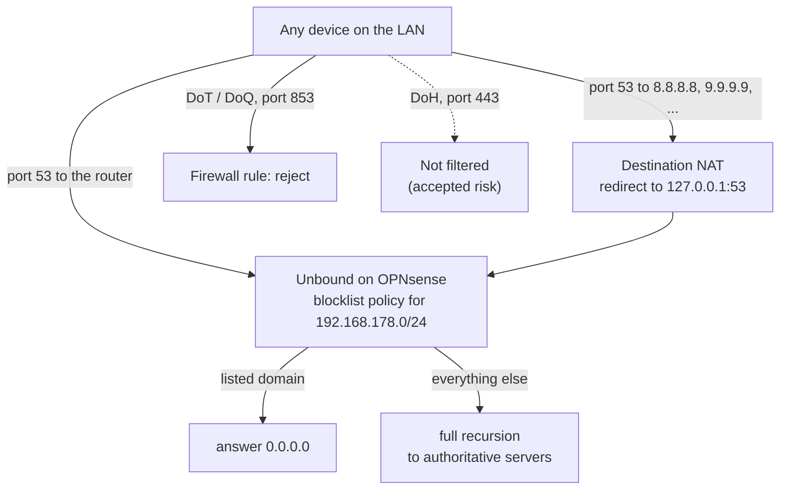

# Phase 4 – DNS filtering for the whole network

*1–4 November 2026 · [Versione italiana](../it/phase-4-dns-filter.md)*

**TL;DR** – Ads, trackers and known malicious domains are now blocked for every device in the house, including phones and apps where no ad blocker can be installed, using the DNS resolver already running on the router. Devices can no longer get around it: plain DNS sent to outside servers is quietly redirected to the filter, and DNS over TLS is refused. Along the way: an unused default service switched off, a stubborn ad network traced through the resolver logs and blocked by its parent domain, and a lesson about DNS caching.

## How a DNS query travels now

## Choosing the tool

Three candidates: Pi-hole in a container, AdGuard Home, or the blocklists built into Unbound, the resolver OPNsense already runs.

- **Unbound blocklists won.** Nothing new to install, run or back up: no extra guest and no extra point of failure on the box that is also the router. The existing VM backups, the encrypted configuration export and the runbook already cover it. Clients query Unbound directly, so the logs show each device's real address. Blocklists are policies tied to source networks, ready for VLANs.
- **Pi-hole** would add a second DNS layer and a new point of failure, and Unbound would only ever see the container.
- **AdGuard Home** as an OPNsense plugin is only available from an unofficial repository and requires switching Unbound off: unnecessary risk on the home router.
- Before deciding, I checked the blocklist model on the installed version (26.7.7) to confirm that several policies with source networks are really supported, instead of relying on older documentation.

## What I built and why

- **One list, one policy.** Lists overlap heavily: stacking them costs memory and false positives without blocking much more, and with one list at a time it is clear which one blocks what. Hagezi Multi NORMAL first, then PRO after a few days of use (PRO contains NORMAL: levels are swapped, never added). The policy applies to `192.168.178.0/24` only, so the management network and the router's own lookups, such as its updates, are never filtered.
- **Nightly list updates.** Without a scheduled job the list stays as it was downloaded on the day it was applied. A job runs at 04:17, away from the 03:00 VM backup and off the full hour, when list servers get everyone's requests. Checked the next morning in the configd log (`returned OK`) and on the timestamp of the processed list.
- **Measured cost.** Unbound went from about 71 MB to about 214 MB of memory with NORMAL; PRO (about 240,000 domains) added about 54 MB to the VM.
- **Plain DNS redirected, not blocked.** A destination NAT rule sends every LAN query on port 53 aimed at a server other than the router to Unbound. Devices with a hardcoded resolver (TVs, apps, some malware) keep working, but filtered. The source address is preserved, so the network policy still applies. The rule logs, which records bypass attempts without recording anyone's browsing.
- **DNS over TLS refused.** It is encrypted, so it can only be blocked, not redirected: a firewall rule rejects TCP and UDP 853 from the LAN (DoT and DoQ), placed above the default allow rules because the first matching rule wins. *Reject* rather than *block*: phones with private DNS on "automatic" fall back to plain DNS immediately instead of waiting for a timeout. Logged too.
- **An unused service switched off.** Dnsmasq was enabled by default since installation and listening on port 53053, with no DHCP ranges (Kea does DHCP) and nothing forwarding to it: no purpose, and a possible way around the filter.
- **Layers, not a replacement.** DNS only sees domain names. The browser keeps its content ad blocker and strict tracking protection; DNS covers everything else on the network.

## What went wrong and how I fixed it

**"Ads still show up on some sites."** Instead of switching to a bigger list straight away, I enabled Unbound's query statistics, reproduced the problem and read the log. On the same ad network, the tracking-pixel subdomain was blocked by the list but the CDN subdomain serving the banners passed, with random-looking numbered names and a 15-second TTL: an ad network rotating hostnames to stay ahead of the lists. A **wildcard on the parent domain** blocks every subdomain, including ones it has not invented yet; verified with a made-up name. A second domain I deliberately left alone: the list blocks only some of its subdomains, a hint that it also serves real content, and a broad block would break sites. Its banners are the browser blocker's job.

**The block that didn't work… yet.** Right after adding the wildcard the domain still resolved. Two causes, found by testing rather than guessing. First, reloading a large list after *Apply* takes about a minute. Second, a made-up name I had queried before the block kept answering `NXDOMAIN`, because negative answers are cached too, and the cache is served until its TTL expires; a never-queried name was blocked at once. The lesson carries over to incidents: blocking a domain does not instantly cut off clients that have already resolved it.

**"Failed to stop", but stopped.** Switching Dnsmasq off returned *Service "dnsmasq" failed to stop*. Three independent checks all said it was off: no process, port closed, disabled in the saved configuration. DNS was retested straight after. The error came from the stop script, not the service.

**A search filter that lied.** Searching the query log for `192.168.178.10` also matched `.100` to `.109`: Android domains among the "workstation's" queries gave it away. Always check what a filter actually matched.

**Privacy.** Query statistics record every domain every device asks for, other people's included. They were on only for the diagnosis, then switched off and wiped.

## How it was verified

| Test from the workstation | Before | After |
|---|---|---|
| Ad domain via the router | `0.0.0.0` | `0.0.0.0` |
| Ad domain via `9.9.9.9` and `8.8.8.8` | real address: filter bypassed | `0.0.0.0` |
| Normal domain via all three | resolves | resolves, with the same address from all three: it is always Unbound answering |
| TCP 853 to `9.9.9.9` and `1.1.1.1` | open | refused immediately |

- After 24 hours with NORMAL: about 10,000 queries, 10.7% blocked, mostly app trackers, browser telemetry, analytics and ad networks; no broken sites.
- An ad-blocker test page with the browser's blocker off: external analytics and ad services blocked, banners served from the page's own domain not, as expected for DNS.
- Phones with private DNS on "automatic" keep working on Wi-Fi; the nightly update returns OK; all tests repeated after updating OPNsense to 26.7.8.

## Still open

- **DNS over HTTPS** is not blocked: it looks like any other HTTPS traffic, and the available bypass list would also block VPNs. The workstation's browser has it switched off. A device using it on purpose, or malware, is an accepted risk at this layer and belongs to threat intelligence and Suricata (Phase 9).
- What happens if a list download fails (old list kept, or none): to be read in the configd log when it happens.
- Reviewing the redirect and DoT logs after a few days: which devices try to use their own DNS.
- An alert on spikes of blocked queries needs the statistics, now off for privacy: to be rethought.

## Skills

DNS security: filtering and resolver-bypass prevention · log-based troubleshooting · NAT and firewall rule design (redirect vs block, rule order) · attack-surface review of listening services · risk acceptance and documentation · privacy-aware monitoring
