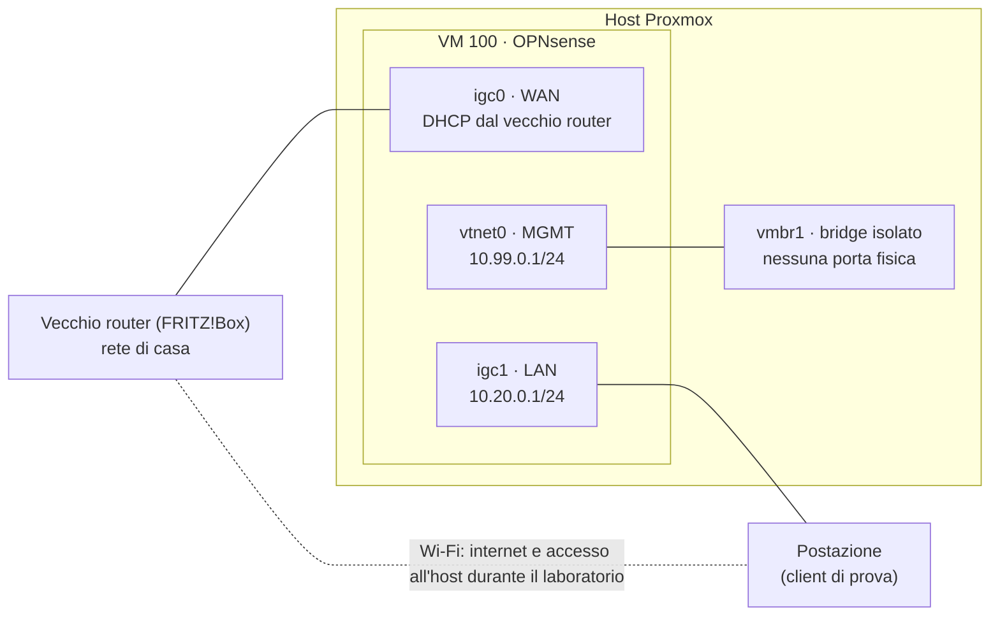

# Fase 2 – OPNsense in laboratorio

*Ottobre 2026 · OPNsense 26.7 su Proxmox VE 9.2 · [English version](../en/phase-2-opnsense-lab.md)*

**In breve** – Il nuovo router, OPNsense in una VM con due porte di rete fisiche in passthrough, è stato costruito e provato dall'inizio alla fine mentre in casa si continuava a usare il vecchio router. Alla fine il passaggio si era ridotto a spostare dei cavi e cambiare un'impostazione, con un piano scritto per tornare indietro.

## Obiettivo

Un firewall completamente configurato e provato prima di toccare la rete di casa: niente lavori a metà il giorno in cui internet si interrompe.

## Schema del laboratorio

## Configurazione della VM

| Impostazione | Valore | Perché |
|---|---|---|
| Macchina, firmware | q35, UEFI senza chiavi Secure Boot | topologia PCIe adatta al passthrough |
| CPU | 4 core, tipo `host` | margine per Suricata (Fase 9) |
| RAM | 4 GB fissi, senza ballooning | con il passthrough PCI tutta la memoria del guest è comunque bloccata |
| Disco | 32 GB sull'NVMe, UFS | più leggero di ZFS; il ripristino passa dai backup di Proxmox |
| Schede di rete | 2 × Intel i226-V in passthrough PCI + 1 scheda virtuale su `vmbr1` | hardware vero per WAN e LAN, un collegamento virtuale per la gestione |

## Cosa ho costruito e perché

- **Passthrough senza modifiche globali.** L'IOMMU (AMD-Vi) era già attivo; ogni porta i226 sta nel suo gruppo IOMMU, la scheda di gestione in un gruppo separato. Le due porte i226 hanno lo stesso ID PCI, quindi un collegamento per ID le prenderebbe entrambe, e non deve mai toccare la scheda di gestione. Ho usato le *Resource Mappings* di Proxmox (`kalea-wan`, `kalea-lan`) per indirizzo PCI invece di un collegamento fisso a `vfio-pci`: l'host tiene i suoi driver finché la VM non parte, e per tornare indietro basta togliere un dispositivo dalla VM.
- **Una gestione che non dipende dal router.** Un bridge Linux isolato (`vmbr1`, senza porta fisica) collega l'host all'interfaccia di gestione di OPNsense; la GUI web si raggiunge con un tunnel SSH verso l'host. Non compare mai sulla LAN di casa e non può sovrapporsi a essa. Una console seriale (`qm terminal 100`) permette il copia-incolla, che la console del browser non ha.
- **Un laboratorio che non può danneggiare la rete di casa.** La porta WAN stava sulla LAN di casa e prendeva l'indirizzo dal vecchio router; la LAN di laboratorio usava una `10.20.0.0/24` temporanea, perché non può stare nella stessa subnet della WAN. La mia postazione faceva da client di prova, con un profilo NetworkManager **senza route predefinita**: solo `1.1.1.1` e `9.9.9.9` passavano da OPNsense, tutto il resto restava sul Wi-Fi. Un errore in OPNsense non poteva togliere internet alla mia postazione né l'accesso all'host.
- **Indirizzi definitivi decisi in laboratorio.** Dopo il passaggio la LAN resta `192.168.178.0/24`, con OPNsense su `.1`, così host, postazione e switch tengono i loro indirizzi; con le VLAN si rinumererà comunque tutto. Schema: `.1–.99` indirizzi fissi e prenotazioni, `.100–.254` DHCP.
- **Servizi.** Kea DHCPv4 con una prenotazione per la postazione, Unbound come resolver, NTP e fuso orario. Nessuna regola firewall senza un motivo: la WAN non ha regole in ingresso (tutto bloccato di default), e le nuove regole arrivano con le fasi che le richiedono.
- **PPPoE preparato, non usato.** La linea in fibra richiede PPPoE sulla VLAN 835. Ho letto i parametri dalla configurazione del vecchio router invece di chiederli al provider, e ho creato i dispositivi VLAN e PPPoE in OPNsense senza assegnarli: il laboratorio ha continuato a usare il DHCP, e il passaggio è diventato una sola modifica (WAN → `pppoe0`).
- **Avvio automatico e ordine.** La VM router parte per prima con l'host e ha 60 s prima di qualsiasi altro guest, perché rete, DHCP e DNS devono essere su per chi viene dopo; ha 120 s per spegnersi in modo pulito.

## Cosa è andato storto e come l'ho risolto

**Nomi che mentono.** I nomi delle interfacce sull'host (`nic1`, `nic2`) erano incrociati rispetto all'ordine fisico delle porte, e l'installer di OPNsense ha assegnato `igc0`/`igc1` incrociati rispetto ai ruoli che avevo previsto. Il trucco del LED lampeggiante (`ethtool -p`) non è supportato da questo driver, quindi ho identificato le porte con un cavo e lo stato del collegamento, le ho etichettate fisicamente e da lì in poi mi sono fidato solo dei MAC: controllati dentro OPNsense, dalla tabella dei vicini della postazione sulla LAN di laboratorio, e di nuovo prima del passaggio.

**Chiuso fuori dalla GUI dalla mia stessa riassegnazione.** Dopo aver riassegnato le interfacce dalla console seriale, l'interfaccia di gestione è salita senza regole firewall, quindi la GUI non era raggiungibile dal tunnel. Sono entrato dalla LAN di laboratorio grazie alla regola anti-lockout e ho aggiunto una regola esplicita: HTTPS dalla rete di gestione all'indirizzo di gestione del firewall, nient'altro.

**La mia postazione contro il laboratorio.** Il normale profilo cablato si collega da solo a qualsiasi cavo: collegato alla LAN di laboratorio, avrebbe sostituito il profilo di prova sicuro. Ho disattivato la sua connessione automatica per tutta la durata del laboratorio e ho scritto i passaggi esatti per tornare indietro.

**Gli strumenti, non il piano.** La console del browser non ha il copia-incolla e la shell di OPNsense è `csh`, dove i cicli di bash non funzionano: la console seriale e `sh -c '…'` hanno risolto entrambe le cose.

## Come è stato verificato

Checklist "pronto al passaggio", tutta spuntata prima della Fase 3:

- il client di prova riceve l'indirizzo dal DHCP e naviga; il DNS risolve (`drill`, `NOERROR`); `tracepath` mostra il percorso previsto;
- l'host resta raggiungibile con la VM router spenta, grazie agli indirizzi fissi;
- un riavvio completo dell'host fa ripartire OPNsense da solo (journal di avvio: VM avviata per prima, poi i 60 s di attesa);
- un backup della VM con il passthrough attivo, verificato con `zstd -t`; **ripristino provato** con `qmrestore` su un nuovo ID con nuovi MAC. La copia non è mai stata avviata, perché due VM non possono usare le stesse porte fisiche: le è stato tolto subito l'avvio automatico, e un `diff` delle due configurazioni ha mostrato solo ID, MAC e UUID diversi;
- configurazione del vecchio router esportata, e un piano scritto per tornare indietro.

Il PPPoE si poteva provare davvero solo con il terminale della fibra collegato a OPNsense: l'unica incognita lasciata di proposito al passaggio.

## Ancora aperto

- **Modalità IPS di Suricata** (Fase 9): dipende dal supporto netmap di queste schede in passthrough, da verificare prima di attivarla.
- **VLAN**: aspettano un access point gestibile; il FRITZ!Box, ora usato come access point, non sa associare le reti Wi-Fi alle VLAN.

## Competenze

Virtualizzazione del firewall · passthrough PCI e IOMMU · indirizzamento IP, DHCP e DNS · costruzione di un ambiente di prova sicuro · preparazione delle modifiche e piani di rientro
