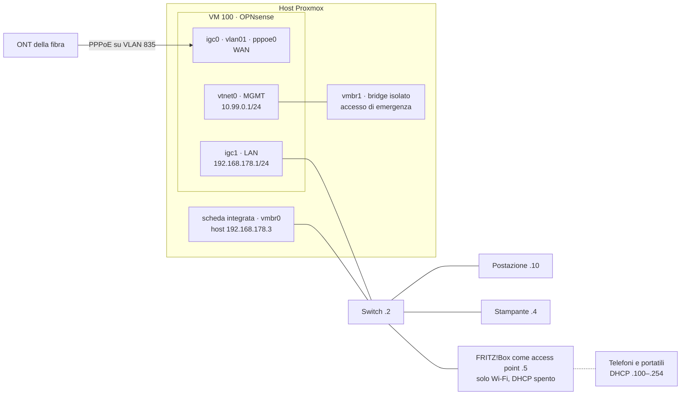

# Fase 3 – Il passaggio: OPNsense diventa il router di casa

*24–25 ottobre 2026 · [English version](../en/phase-3-cutover.md)*

**In breve** – La linea in fibra è passata dal vecchio router a OPNsense in un pomeriggio, un'incognita alla volta, lasciando intatto il vecchio router come via di ritorno. Poi è stato verificato tutto (DHCP, DNS, MTU, Wi-Fi, un riavvio completo), il router ha avuto un vero monitoraggio del gateway e avvisi su Telegram tramite un utente API con privilegi minimi, e la sua configurazione è stata salvata cifrata.

## Schema finale

## Il piano: un'incognita alla volta

1. Il vecchio router è rimasto **invariato e spento** durante il passaggio: tornare indietro voleva dire spostare un cavo.
2. **Prima il PPPoE**, l'unica cosa che il laboratorio non poteva provare: il dispositivo `pppoe0` già pronto è stato assegnato alla WAN, e la sessione è stata controllata (indirizzo, gateway, internet) prima di cambiare qualsiasi altra cosa.
3. **Poi la LAN**: rinumerata dalla subnet di laboratorio a `192.168.178.1/24`, pool DHCP `.100–.254`, prenotazione della postazione, lease portato da circa un'ora a un giorno.
4. **Il vecchio router è tornato** solo come access point, configurato prima in isolamento (vedi sotto).

## Cosa ho costruito e perché

- **La fibra direttamente nel firewall.** L'ONT è collegato alla porta WAN di OPNsense, e il PPPoE passa sulla VLAN 835 di quella porta. La porta fisica è assegnata come interfaccia senza indirizzo (`WANPHY`): una VLAN sale solo se il suo dispositivo padre è attivo.
- **Il vecchio router come semplice access point.** FRITZ!Box in modalità "client IP" con indirizzo fisso (`.5`), DHCP e NAT spenti, IPv6 spento, collegato con una delle sue porte LAN. Fa il Wi-Fi su due bande e nient'altro.
- **Gestione fuori dal percorso del router.** La scheda integrata dell'host va direttamente allo switch con un indirizzo fisso, così Proxmox resta raggiungibile con OPNsense spenta; il bridge di gestione isolato resta come via di emergenza per la GUI del router.
- **IPv6 spento di proposito, per ora.** Farlo bene raddoppia regole firewall, filtro DNS, VPN e analisi dell'IDS, e una regola sbagliata può esporre i dispositivi a internet. Avrà una fase dedicata.

## Cosa è andato storto e come l'ho risolto

**Due server DHCP sono uno di troppo, quindi ho dimostrato che ce n'era uno solo.** Il FRITZ!Box è stato configurato come access point su un cavo isolato, con la mia postazione su un profilo temporaneo senza route predefinita e internet dall'hotspot del telefono. Prima di collegarlo alla LAN ho verificato che il suo server DHCP fosse spento con `nmap --script broadcast-dhcp-discover` (nessuna risposta). Dopo il passaggio, lo stesso test sulla LAN riceve una sola offerta, da OPNsense.

**L'indirizzo che avevo previsto era occupato.** Volevo mettere l'access point su `.4`. I ping verso `.4` tornavano con due TTL diversi, 64 e 255: rispondevano due dispositivi. La pagina web su `.4` era quella della stampante, che aveva un indirizzo fisso impostato sul dispositivo stesso, invisibile in qualsiasi tabella DHCP. L'access point è andato su `.5`, e prima di assegnare un indirizzo fisso ora scansiono la LAN con `arp-scan`, che segnala i duplicati.

**L'avviso di avvio che non arrivava mai.** Dopo il passaggio, il messaggio Telegram "sono di nuovo online" dell'host falliva a ogni riavvio: partiva una volta sola all'avvio, ma ora internet arriva da una VM sullo stesso host, che non è ancora su. Ora l'avviso riprova ogni 15 s per un massimo di 15 minuti senza trattenere l'avvio, e riporta dopo quanto tempo è tornato internet (57 s al riavvio di prova).

**Una luce verde che non misurava niente.** Il gateway WAN risultava online, ma il monitoraggio era disattivato: l'icona non misurava nulla. Ho attivato `dpinger` verso un resolver pubblico (`9.9.9.9`) invece che verso il peer PPPoE, che può non rispondere ai ping e dimostra solo il primo salto. Con una sola WAN il cambio automatico di gateway resta spento, così un falso "giù" non può mai cambiare il routing.

**Privilegi API che non restavano salvati.** Per gli avvisi ho creato in OPNsense un utente API dedicato con solo due privilegi (stato dei gateway, stato delle interfacce). Impostati dal modulo dell'utente non venivano salvati, e l'API continuava a rispondere `403`; assegnati dalla pagina dei privilegi hanno funzionato, con conferma nel `config.xml`. I codici di risposta raccontavano tutto: `302` (rimando alla pagina di login) senza credenziali, `403` con le credenziali ma senza il privilegio.

## Come è stato verificato

- `192.168.178.1` risponde con il MAC della porta LAN passata alla VM;
- una sola offerta DHCP sulla LAN, da OPNsense (dominio `home.arpa`, lease di un giorno);
- la WAN ha un indirizzo pubblico e il gateway del provider;
- **MTU 1492** (PPPoE): `ping -M do -s 1464 1.1.1.1` passa, e con 1465 OPNsense risponde "mtu = 1492";
- HTTPS e DNS dalla postazione; aggiornamenti dei pacchetti e un messaggio Telegram dall'host;
- Wi-Fi a 2,4 e 5 GHz da due telefoni e un portatile, tutti con indirizzi da `.100` in su e gateway e DNS su `.1`;
- riavvio completo dell'host: OPNsense riparte da sola, il PPPoE si ricollega, internet 57 s dopo l'avvio.

## Dopo il passaggio

- **Avvisi del router su Telegram** (`opnsense-check`, vedi [`scripts/miniserver/`](../../scripts/miniserver/)): VM ferma, API muta, PPPoE giù, gateway giù o degradato, IP pubblico cambiato. Le interruzioni arrivano con la loro durata appena internet torna.
- **Backup:** configurazione di OPNsense esportata **cifrata**, e cancellato il vecchio export di laboratorio non cifrato, con le credenziali PPPoE in chiaro; configurazione dell'access point esportata; un backup della VM *protetto* come punto di ripristino fisso; una seconda copia di questi file sul disco dei backup dell'host, verificata con SHA-256.
- **Procedura di emergenza** estesa al router: niente internet, solo DNS, DHCP, PPPoE, configurazione rotta, ripristino della VM, VM persa senza backup utilizzabile, reset dell'access point. Dopo un reset tornerebbe router con DHCP su `.1`, l'indirizzo di OPNsense: va scollegato prima.

## Ancora aperto

- **Ripristino sul posto della VM router** dal backup protetto: provato nella Fase 2 su una copia, non ancora sul posto, perché lascia tutta la casa senza internet per qualche minuto.
- **IPv6** (fase dedicata), **filtro DNS** (Fase 4), **VPN** (Fase 5). L'IP pubblico è dinamico: il DDNS arriverà con la VPN.

## Competenze

Gestione delle modifiche e piani di rientro · PPPoE su VLAN · DHCP e indirizzamento su una rete in uso · troubleshooting di rete (TTL, ARP, MTU) · monitoraggio e accesso API con privilegi minimi
