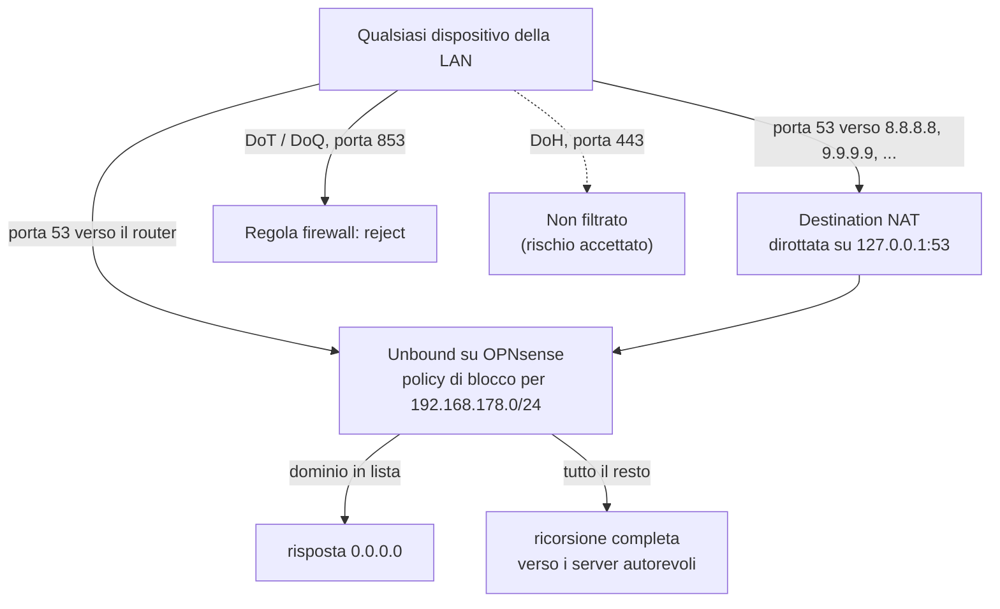

# Fase 4 – Filtro DNS per tutta la rete

*1–4 novembre 2026 · [English version](../en/phase-4-dns-filter.md)*

**In breve** – Pubblicità, tracker e domini malevoli noti ora sono bloccati per tutti i dispositivi di casa, compresi telefoni e app dove non si può installare un adblock, usando il resolver DNS che già gira sul router. I dispositivi non possono più aggirarlo: il DNS in chiaro mandato a server esterni viene dirottato senza che se ne accorgano sul filtro, e il DNS su TLS viene rifiutato. Strada facendo: un servizio di serie inutilizzato spento, una rete pubblicitaria ostinata rintracciata nei log del resolver e bloccata dal dominio padre, e una lezione sulla cache del DNS.

## Come viaggia ora una richiesta DNS

## La scelta dello strumento

Tre candidati: Pi-hole in un container, AdGuard Home, oppure le blocklist integrate in Unbound, il resolver che OPNsense usa già.

- **Hanno vinto le blocklist di Unbound.** Niente di nuovo da installare, far girare o salvare: nessun guest in più e nessun nuovo punto di guasto sulla macchina che fa anche da router. I backup della VM, l'export cifrato della configurazione e la procedura di emergenza lo coprono già. I client interrogano direttamente Unbound, quindi i log mostrano l'indirizzo vero di ogni dispositivo. Le blocklist sono policy legate alle reti di origine, già pronte per le VLAN.
- **Pi-hole** avrebbe aggiunto un secondo livello DNS e un nuovo punto di guasto, e Unbound avrebbe visto solo il container.
- **AdGuard Home** come plugin di OPNsense arriva solo da un repository non ufficiale e richiede di spegnere Unbound: un rischio inutile sul router di casa.
- Prima di decidere ho controllato il modello delle blocklist sulla versione installata (26.7.7), per confermare che supporti davvero più policy con reti di origine, invece di fidarmi di documentazione più vecchia.

## Cosa ho costruito e perché

- **Una lista, una policy.** Le liste si sovrappongono molto: sommarle costa memoria e falsi positivi quasi senza bloccare di più, e con una lista alla volta si capisce chi blocca cosa. Prima Hagezi Multi NORMAL, poi PRO dopo qualche giorno d'uso (PRO contiene NORMAL: i livelli si sostituiscono, non si sommano). La policy vale solo per `192.168.178.0/24`, così la rete di gestione e le richieste del router stesso, come i suoi aggiornamenti, non vengono mai filtrate.
- **Aggiornamento notturno della lista.** Senza un'attività pianificata la lista resta quella scaricata il giorno in cui è stata applicata. L'attività gira alle 04:17, lontano dal backup della VM delle 03:00 e fuori dall'ora esatta, quando i server delle liste ricevono le richieste di tutti. Verificata la mattina dopo nel log di configd (`returned OK`) e sull'orario della lista elaborata.
- **Costo misurato.** Unbound è passato da circa 71 MB a circa 214 MB di memoria con NORMAL; PRO (circa 240.000 domini) ha aggiunto circa 54 MB alla VM.
- **DNS in chiaro dirottato, non bloccato.** Una regola di destination NAT manda a Unbound ogni richiesta della LAN sulla porta 53 diretta a un server diverso dal router. I dispositivi con un resolver scritto nel codice (TV, app, alcuni malware) continuano a funzionare, ma filtrati. L'indirizzo di origine resta quello vero, quindi la policy per rete continua a valere. La regola ha il log attivo: registra i tentativi di aggirare il filtro, non la navigazione di nessuno.
- **DNS su TLS rifiutato.** È cifrato, quindi si può solo bloccare, non dirottare: una regola firewall rifiuta TCP e UDP 853 dalla LAN (DoT e DoQ), messa sopra le regole "allow" predefinite perché vale la prima regola che corrisponde. *Reject* invece di *block*: i telefoni col DNS privato su "automatico" ripiegano subito sul DNS normale, senza aspettare un timeout. Anche qui il log è attivo.
- **Un servizio inutilizzato spento.** Dnsmasq era acceso di serie dall'installazione e ascoltava sulla porta 53053, senza intervalli DHCP (il DHCP lo fa Kea) e senza nessuno che gli inoltrasse richieste: nessuno scopo, e una possibile via per aggirare il filtro.
- **Strati, non un sostituto.** Il DNS vede solo i nomi di dominio. Il browser tiene il suo adblock e la protezione antitracciamento restrittiva; il DNS copre tutto il resto della rete.

## Cosa è andato storto e come l'ho risolto

**"Su alcuni siti la pubblicità si vede ancora."** Invece di passare subito a una lista più grande, ho attivato le statistiche delle query di Unbound, ho riprodotto il problema e ho letto il log. Sulla stessa rete pubblicitaria, il sottodominio del pixel di tracciamento era bloccato dalla lista, ma quello della CDN che serviva i banner passava, con nomi numerati dall'aria casuale e un TTL di 15 secondi: una rete pubblicitaria che cambia nomi per restare un passo avanti alle liste. Una **wildcard sul dominio padre** blocca tutti i sottodomini, anche quelli non ancora inventati; verificato con un nome inventato. Un secondo dominio l'ho lasciato stare apposta: la lista ne blocca solo alcuni sottodomini, segno che serve anche contenuti veri, e un blocco troppo largo romperebbe dei siti. I suoi banner sono compito dell'adblock del browser.

**Il blocco che non funzionava… ancora.** Subito dopo aver aggiunto la wildcard il dominio risolveva ancora. Due cause, trovate provando invece di supporre. La prima: con una lista grande, il ricaricamento dopo *Apply* richiede circa un minuto. La seconda: un nome inventato che avevo chiesto prima del blocco continuava a rispondere `NXDOMAIN`, perché anche le risposte negative vanno in cache, e la cache viene servita finché il TTL non scade; un nome mai chiesto è stato bloccato subito. La lezione vale anche negli incidenti: bloccare un dominio non taglia fuori subito i client che l'avevano già risolto.

**"Failed to stop", ma era fermo.** Spegnendo Dnsmasq è comparso *Service "dnsmasq" failed to stop*. Tre controlli indipendenti dicevano tutti che era spento: nessun processo, porta chiusa, disattivato nella configurazione salvata. Il DNS è stato riprovato subito dopo. L'errore veniva dallo script di arresto, non dal servizio.

**Un filtro di ricerca che mentiva.** Cercando `192.168.178.10` nel log delle query uscivano anche `.100`–`.109`: lo hanno tradito alcuni domini Android tra le query "della postazione". Bisogna sempre controllare cosa ha davvero preso un filtro.

**Privacy.** Le statistiche delle query registrano ogni dominio chiesto da ogni dispositivo, compresi quelli di altre persone. Sono rimaste accese solo per la diagnosi, poi spente e cancellate.

## Come è stato verificato

| Prova dalla postazione | Prima | Dopo |
|---|---|---|
| Dominio pubblicitario tramite il router | `0.0.0.0` | `0.0.0.0` |
| Dominio pubblicitario tramite `9.9.9.9` e `8.8.8.8` | indirizzo vero: filtro aggirato | `0.0.0.0` |
| Dominio normale tramite tutti e tre | risolve | risolve, con lo stesso indirizzo da tutti e tre: risponde sempre Unbound |
| TCP 853 verso `9.9.9.9` e `1.1.1.1` | aperta | rifiutata subito |

- Dopo 24 ore con NORMAL: circa 10.000 query, 10,7% bloccate, soprattutto tracker delle app, telemetria del browser, servizi di analisi e reti pubblicitarie; nessun sito rotto.
- Una pagina di test per adblock, con l'adblock del browser spento: servizi esterni di analisi e pubblicità bloccati, banner serviti dal dominio della pagina stessa no, come ci si aspetta da un filtro DNS.
- Telefoni col DNS privato su "automatico" funzionanti in Wi-Fi; aggiornamento notturno con esito OK; tutte le prove ripetute dopo l'aggiornamento di OPNsense a 26.7.8.

## Ancora aperto

- **DNS su HTTPS** non bloccato: sembra normale traffico HTTPS, e la lista disponibile per bloccarlo bloccherebbe anche le VPN. Il browser della postazione lo ha disattivato. Un dispositivo che lo usa apposta, o un malware, è un rischio accettato a questo livello e riguarda la threat intelligence e Suricata (Fase 9).
- Cosa succede se il download di una lista fallisce (resta la lista vecchia o nessuna): da leggere nel log di configd quando capiterà.
- Rileggere dopo qualche giorno i log del dirottamento e del DoT: quali dispositivi provano a usare un DNS proprio.
- Un avviso sui picchi di query bloccate richiede le statistiche, ora spente per privacy: da ripensare.

## Competenze

Sicurezza del DNS: filtro e prevenzione dell'aggiramento del resolver · troubleshooting basato sui log · progettazione di regole NAT e firewall (dirottare o bloccare, ordine delle regole) · revisione della superficie d'attacco dei servizi in ascolto · accettazione e documentazione del rischio · monitoraggio attento alla privacy
